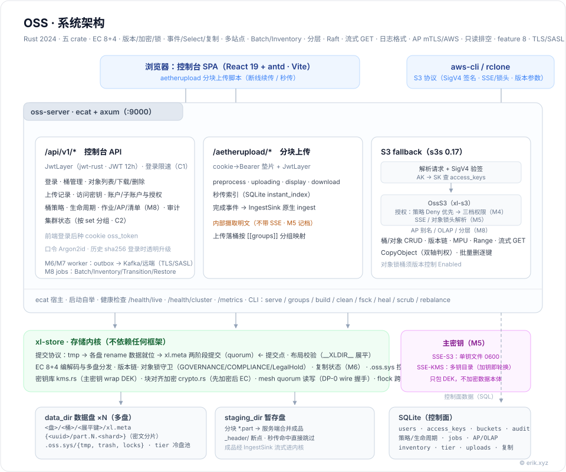
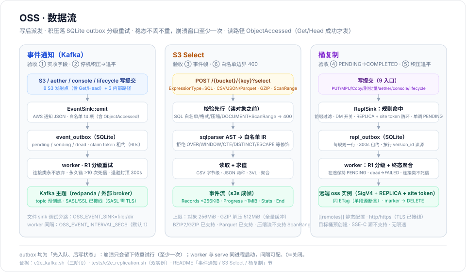
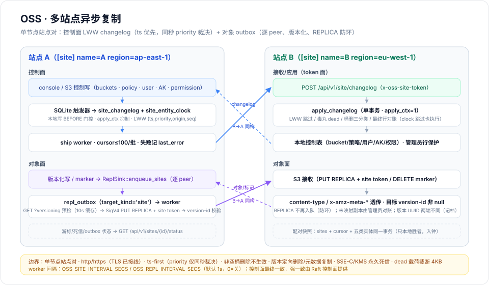
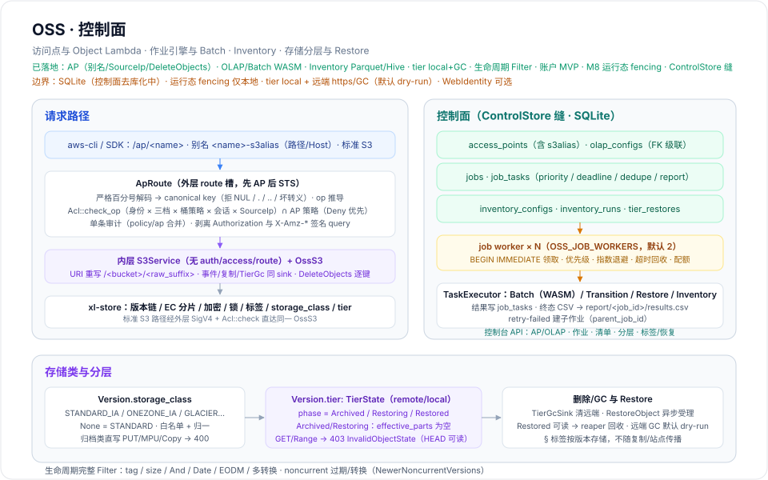
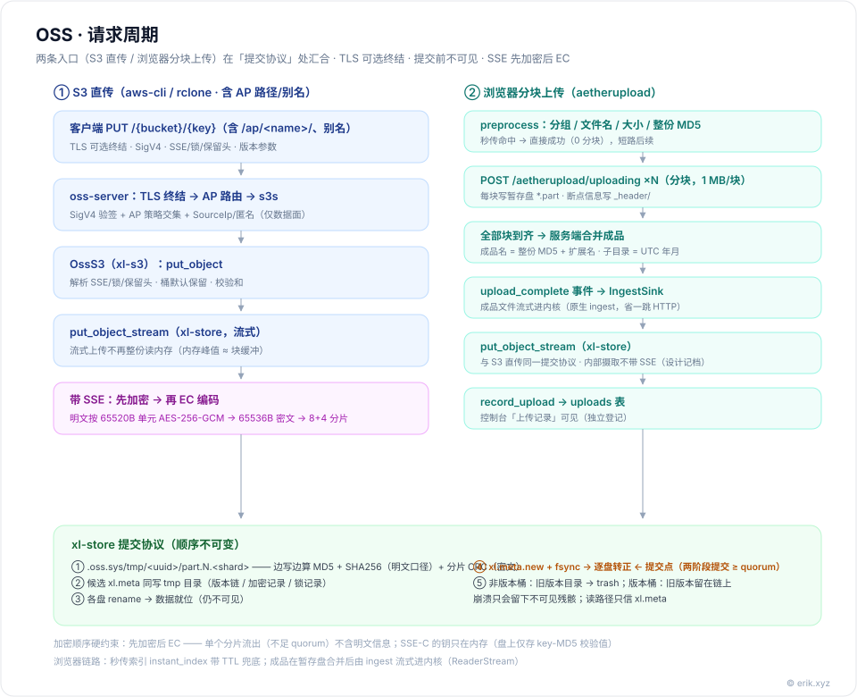
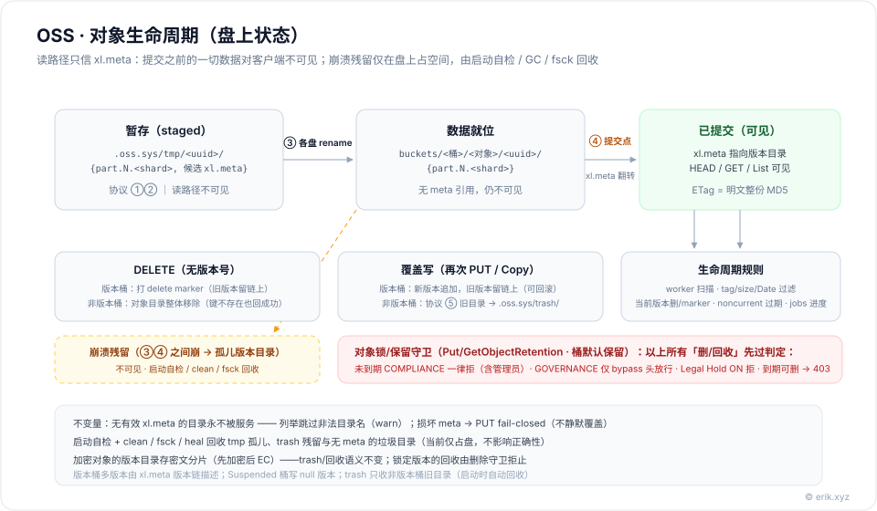

# oss (TunTun) — A Self-Built Distributed Object Storage System

[简体中文](README.md) | English

   

**Chinese project name: 吞吞 (TunTun) · English name: oss · Project pet: TunTun (吞吞)** — a little creature that swallows object blocks into its bucket.

An S3-compatible, self-built distributed object storage system (an equivalent implementation of MinIO). It supports multi-drive erasure coding 8+4, inter-node gRPC mesh, versioning, lifecycle, bucket policies and auditing, three SSE modes and object lock, STS temporary credentials, event notifications/Kafka, S3 Select, bucket and multi-site replication, access points/Object Lambda, Batch/Inventory/tiering, sync buckets and a 3-voter Raft control plane. The default `aws-cli`/`rclone` large-file paths (automatic multipart for ≥8 MiB) and resume habits work directly; the browser console supports chunked uploads and management.

**Latest release: v1.31.0 (2026-11-06).** v1.31 ships the object control-store backend (opt-in `[server].control_backend = "objects"`): every control table is a node-local copy-on-write B+tree under `.oss.sys`, with one root CAS commit point, per-drive majority quorum, a startup flock, and content-addressed blobs; all 27 control tables (IAM, accounts, buckets, policies, jobs, outboxes, sites, audit, uploads, instant index) have object adapters, and the hot read view swaps per root generation, rebuilding only dirty domains. Raft control state uses file log/meta/snapshot stores (`<db_path>.d/`) and a metadata-only witness state machine; site replication (LWW apply/ship/pairing) runs on the seam with node-local cursors and dead letters; account usage stays in a node-local cache while a sampler checkpoints the replicated ledger. The offline `control-migrate` tool keeps byte-level verification and a rollback window, and the A8 goldens are the permanent object-backend oracle. Performance: a 100k-row snapshot now imports in 8.3s and exports in 1.5s (import previously timed out), and metadata-only commits no longer trigger a full hot-view reload. SQLite remains the default backend and objects are opt-in; there are no API, wire/OSSCTL, or data-format changes. Removing SQLite is the next step.

## Features

| Area | Capability |
|---|---|
| Storage kernel | Multi-drive erasure coding 8+4, inter-node gRPC mesh, quorum commit, `xl.meta` version chain, small-object inlining, multi-drive self-healing, streaming full-object GET, parallel shard writes, listing key cache |
| S3 API | Objects/buckets/versions/tags, Multipart, partNumber, Range, Copy directives, chunked upload and resume |
| Lifecycle | Expiration, noncurrent versions, transition rules, Storage Classes, tiering and Restore |
| Security | SSE-S3/KMS/C, key vault, object lock and retention, STS, bucket policies and auditing (async batch queue), TLS/mTLS, three-tier sub-account permissions, Argon2id, account soft/hard byte and object quotas |
| Data flow | Event notifications/Kafka, S3 Select, bucket replication (Prefix/Tag/And filters), multi-site replication |
| Control plane | Access points, Object Lambda, Batch Operations, Inventory, job engine with terminal retention (JobPurge), restore post-state/lease replication (feature 7), hard-quota/VPC endpoint commands (feature 8), replicated usage ledger (feature 9), console pages |
| Strong consistency | Sync buckets, stretch 2×6, 3-voter Raft (witness), feature levels 1..9 |
| Operations | `fsck` / `heal` / `scrub` / `clean` / `rebalance` / `cluster-shrink plan/apply/verify/commit/rollback` |
| Clients | `aws-cli` / `rclone`; React console (chunking, resume, instant upload) |

## Architecture



Data flow (event notifications / S3 Select / bucket replication):



Multi-site async replication (control-plane changelog + object outbox):



Control plane (access points and OLAP / jobs and Batch / Inventory / tiering and Restore / console pages):



| crate / directory | Responsibility |
|---|---|
| `crates/xl-store` | Storage kernel: drive layout and key validation (`__XLDIR__` flattening), `xl.meta` encoding/decoding (version chain / encryption records / lock records / tags / storage_class / tier), commit protocol, EC encode/decode, multi-drive distribution and quorum, object/bucket locks and flock, key vault (`kms.rs`) and block-aligned envelope encryption (`crypto.rs`) |
| `crates/xl-s3` | s3s `S3` trait implementation: DTO translation, error mapping, SigV4 authentication (AK → SK lookup in SQLite `access_keys`), SSE and object-lock header parsing/response assembly; includes access point routing (`ap.rs`), Object Lambda (`olap.rs`), Restore/lifecycle (`restore.rs`/`lifecycle.rs`), TierGc/bucket-delete cleanup contract |
| `crates/xl-proto` | Inter-node gRPC protocol: `oss.proto` messages and service definitions (fully generated by prost + tonic-build) |
| `crates/xl-client` | tonic implementation of the mesh: `TonicMesh` client (lazy connect / timeouts / token interceptor + traceparent injection) and server-side handler (token validation, only operates on this node's local slots) |
| `crates/oss-server` | ecat + axum assembly: console API (JWT), aetherupload wiring, S3 fallback, ops CLI; includes job engine (`jobs.rs`), Batch (`job_actions*.rs`), access points/OLAP (`access_points_api.rs`), Inventory (`inventory*.rs`), tiering/restore (`tier*.rs`) and the 0003 migration |
| `web` | Console frontend: React 19 + antd + Vite, Playwright e2e; includes access point/job/tier/inventory/notification/audit/settings pages |

Disk layout quick note (multi-drive): each drive holds one **complete namespace** — under `<drive>/<bucket>/<flattened-key>/` are `xl.meta` (this drive's replica) and version directories `<uuid>/part.1.<shard>` (the shards that land on this drive; in single-drive form, all shards). **A commit is always "data in place first → meta flip"**: single drive = rename on the same drive; multi-drive = two-phase meta commit per drive (prepare `xl.meta.new` on all drives ≥ quorum before flipping each to final; reads pick the **newest replica**). Small objects (< 128 KiB) are inlined into `xl.meta` and do not get data files. With encryption enabled, data files hold **ciphertext shards** (encrypt then EC), and the wrapped DEK and `key_id` are recorded inside `xl.meta` (the metadata itself contains no plaintext keys). Scratch areas are under `.oss.sys/{tmp, trash, locks}` on each drive; the `drive-id` drive identity marker prevents using the wrong drive.
Control-plane metadata (users/keys/buckets/upload records/instant-upload index) lives in SQLite.

**Tech stack**: Rust 2024 · ecat 7.0 · s3s 0.17 · aetherupload-rust 3.0.0 · axum 0.8 · sqlx / SQLite · serde + rmp-serde.

## Request Lifecycle



Both entry points (direct S3 upload, browser chunked upload) converge at xl-store's **commit protocol**: stage → rename data into place on the same drive → overwrite `xl.meta` to commit; everything before commit is invisible to clients. EC writes/reads are chunk-streamed: peak memory ≈ the block buffer (MiB level), independent of object size (a 96 MiB object measured VmHWM 107 MiB for range reads). Full-object GET without Range streams directly (encrypted objects decrypt one unit at a time, buffering at most one); remote EC shards are read in batches of `OSS_SHARD_READ_BATCH_BYTES` (1 MiB default, 16 MiB cap) to reduce RPCs. Range/partNumber reads stay bounded and are capped by `OSS_MAX_BUFFERED_GET_BYTES` (default 512 MiB, 0=unlimited), which also caps the buffered EC-rebuild fallback when a data shard is unavailable. A single list collects at most `OSS_LIST_MAX_KEYS` keys (default 1,000,000, 0=unlimited) — use prefixes for large buckets; after the first listing each node caches the bucket's key set (`OSS_KEY_CACHE_MAX_KEYS`/`OSS_KEY_CACHE_MAX_TOTAL_KEYS`, 2,000,000 each by default; `OSS_KEY_CACHE_TTL_SECS`, 300 s, 0 disables periodic rebuild; over-cap buckets fall back to per-page scans). Audit logs are retained for 90 days by default (`OSS_AUDIT_RETENTION_DAYS=0` disables cleanup); expired instant-upload index rows are purged hourly. Audit writes go through a bounded async queue (one worker flushes every 100 ms or 256 rows); when the queue is full, rows are dropped and a drop counter is incremented (warning on the first drop and every 1000) — auditing is best-effort and never blocks or changes request outcomes. `jobs`/`job_tasks` run-state is carried in the Raft snapshot (`m8.runstate`, hard cap 64 MiB); terminal jobs are retained for 30 days by default (`OSS_JOB_RETENTION_DAYS`, 0 disables, max 3650) and purged hourly by the leader in batches through the feature-level-6 `JobPurge` command. `queued`/`running`/`preempted` jobs are never deleted. Enabling feature 6 requires upgrading the whole cluster: old nodes advertise ≤5, the effective level stays at 5, and `JobPurge` is rejected before append (one-way gate, no rollback after activation). Feature level 7 restore-post-state/lease commands require the same full-cluster upgrade; old nodes advertise ≤6 and the effective level stays at 6. Hard-quota configuration works in standalone and Raft (feature level 8); the Raft path requires the whole cluster on level 8 first — older nodes are rejected before append. Enforcement applies once limits are present. The default enforcement remains each node's local `account_usage` cache (bounded cross-node staleness; reject only on the known lower bound when a peer is unreachable, fail-open on unknown increments). Enable strict mode (feature level 9, below) when overselling is not acceptable.

## Strict hard quota (feature 9)

`[quota].strict = true` (or `OSS_ACCOUNT_QUOTA_STRICT=1`) enables opt-in strict mode: xl-s3 Put/CompleteMultipartUpload/Copy reserve through the Raft `AccountUsageReserve` command before writing, and deletes/failures use `AccountUsageRelease`/`AccountUsageAdjust` to release or calibrate. Decisions read the replicated `account_usage_ledger` table, so every node sees the same usage. Non-strict behavior is unchanged.

- **Gate**: Raft mode requires `[raft].feature_level = 9` (currently `MAX_FEATURE_LEVEL`), and commands can be appended only after every peer's effective level reaches 9; the leader rejects lower-level peers before append. OSSCTL3 snapshots add `account_usage_ledger` rows to `ControlData`; installing a level <9 snapshot over a local DB that already has ledger rows is refused, so a whole-table replace cannot silently drop usage.
- **Conservative limits**: ledger commands are non-idempotent — an ambiguous append fails the write closed and is never retried; the first touch of an account is seeded from the leader's local `account_usage` cache (up to 60 s stale), then converges through commands; an unknown-length Put reserves 0 bytes and calibrates after the write, so concurrent writers can transiently exceed; version-directed and SSE-C deletes do not release, so over-count can persist until manual reconciliation; a crash after reserve but before the data write leaves the reservation counted.
- **Result**: conservative overall — it will not persistently oversell from an under-counted ledger, but it can over-count/block until reconciliation; the unknown-length Put concurrency window is the only transient over-quota exception.

## Object Lifecycle



The read path trusts only `xl.meta`: directories without valid meta are never served; a crash can only leave invisible debris (orphan version directories / leftover trash / incomplete multipart staging areas). At startup the service self-checks and clears `tmp`/`trash`; `oss-server clean <days>` reclaims the remaining debris by mtime.

Bucket lifecycle rules handle expiration, noncurrent-version cleanup, Storage Class transitions, and tiered Restore; archived objects must be restored before reading.

## Installation

### From Source

```bash
# 1. Start the service (first start creates data/staging/bucket directories and the admin)
OSS_ADMIN_USER=erik OSS_ADMIN_PASSWORD=changeme cargo run -p oss-server

# 2. Log in to get a token
TOKEN=$(curl -s -X POST localhost:9000/api/v1/login -H 'content-type: application/json' \
  -d '{"username":"erik","password":"changeme"}' | python3 -c 'import json,sys;print(json.load(sys.stdin)["token"])')

# 3. Create an access key pair for S3 clients (re-running is idempotent)
curl -s -X POST localhost:9000/api/v1/access-keys -H "authorization: Bearer $TOKEN" \
  -H 'content-type: application/json' \
  -d '{"access_key":"AKIA_TEST_ACCESS_KEY","secret_key":"SK_TEST_SECRET_KEY_0001"}'
```

> `oss.toml` defaults to `listen = "127.0.0.1:9000"` (local only) and a placeholder `jwt_secret` for local development only. If you change `listen` to a non-loopback address, the placeholder secret **refuses to start**; set a random `jwt_secret` before exposing the service.

### Docker

Single node (oss-server + console nginx):

```bash
docker compose up --build        # console http://localhost:8080 · S3/API http://localhost:9000
```

Cluster (4 nodes × 3 drives = 12 slots; service names are node addresses):

```bash
docker compose -f docker-compose.cluster.yml up --build
# S3/control-plane entry: n1:9000 · n2:9001 · n3:9002 · n4:9003 (any node equivalent); console :8080 reverse-proxies n1
```

- Config: single node `docker/oss.toml`; cluster `docker/cluster/n{1..4}/oss.toml` (static topology, commented in the files).
- If `jwt_secret` / cluster `secret` / the admin password are unset, they are generated on first start and written to `./docker/secrets/generated.env` (mode **0600**, owner `oss`, directory 0700); rotate by deleting that file and restarting. Read it with `docker compose exec oss cat /secrets/generated.env` (cluster: `docker compose -f docker-compose.cluster.yml exec n1 cat /secrets/generated.env`), or `sudo cat docker/secrets/generated.env` on the host.
- Published ports bind `127.0.0.1` by default (9000 S3/API, 8080 console). To expose externally, remove the `127.0.0.1:` prefix from the compose port mapping and add TLS/reverse proxy plus access control yourself; inter-container traffic still uses the `oss:9000` service name and is unaffected.
- The console image still runs `nginx:alpine` with its default root master process on :80; making it non-root requires a non-privileged base image/port and matching compose/healthcheck changes (not done here).
- Data/staging live in named volumes (cleared only by `docker compose down -v`); each cluster node has its own volume.

### Console

```bash
# 1. Start the backend (same as "From Source")
OSS_ADMIN_USER=erik OSS_ADMIN_PASSWORD=changeme cargo run -p oss-server
# 2. Start the frontend (another terminal)
cd web && npm install && npm run dev
# 3. Open http://127.0.0.1:5173 and log in with the account above
```

> Full TLS, cluster, strong-consistency, and production deployment instructions are in the [installation docs](https://oss.erik.xyz/install.html).

## Usage

```bash
export AWS_ACCESS_KEY_ID=...
export AWS_SECRET_ACCESS_KEY=...
export AWS_DEFAULT_REGION=us-east-1
E=http://127.0.0.1:9000

aws --endpoint-url $E s3 mb s3://photos
aws --endpoint-url $E s3 cp ./cover.jpg s3://photos/cover.jpg
aws --endpoint-url $E s3 ls s3://photos/
aws --endpoint-url $E s3 presign s3://photos/cover.jpg --expires-in 3600
aws --endpoint-url $E s3 rm s3://photos/cover.jpg
```

- Large files automatically use multipart; Range, `x-amz-meta-*`, Storage Class, and object tags follow S3 semantics.
- The browser console covers buckets, objects, users, access keys, permissions, access points, jobs, Inventory, tiering, and Raft cluster status.
- Versioning, lifecycle, encryption, object lock, STS, event notifications, replication, strong consistency, and ops commands are covered in the [usage docs](https://oss.erik.xyz/usage.html).
- The full API and protocol boundaries are in the [API docs](https://oss.erik.xyz/api.html).

## Upgrade and Rollback

Data-plane upgrades in this version are **stop-the-world blue-green**, not rolling: start the new binary on the original data directories and cut traffic over; rolling back to the old binary is valid only if no new-format writes occurred.

1. Before upgrading, run the read-only preflight: `scripts/upgrade-preflight.sh --data-dir <dirs...> --health-json <saved /health/cluster> --strict --require-no-mpu`.
2. Stop client traffic and the old service; confirm there are no writers.
3. Take a cold backup of every data directory and the control DB; keep it until acceptance.
4. Start the new binary on the same data directories; check `/health/ready` and `/health/cluster` (`data_plane_compatible: true`, every peer `data_wire_version >= 2`).
5. Shift traffic; keep the backup.
6. Rollback = stop the new binary, restore the cold backup, start the old binary — valid only if no new-format/CMK writes occurred; otherwise use the CMK migration below or stay forward.

`scripts/blue-green-preflight.sh` gates the same procedure read-only: `--data-dir`, `--backup`, `--config`, `--health-json`, `--health-url`, `--new-binary`, `--min-version`, `--strict`, `--json`; it never modifies data or stops services.

**Read-only drain (Level C).** Top-level `read_only = true` removes a node from the client write path: writes return 503 with `x-oss-read-only: 1`; GET/HEAD/OPTIONS, the exact `POST /api/v1/login`, health/metrics, and Raft RPC remain available, and `/health/cluster` exposes `read_only`. Old binaries have no such switch, so any mixed-version drain must remove old nodes from the client load balancer; the flag cannot constrain them.

**JWT key rotation.** `jwt_previous_secrets` accepts an array of old signing keys (each ≥32 bytes, unique, and distinct from `jwt_secret`); multi-key verification shares the blacklist and expiry checks. Rotation order: add the current key to `jwt_previous_secrets` → restart every node → switch `jwt_secret` → restart every node → remove the old key after 12 hours. Login rate limiting and audit remain node-local by design and are not replicated.

**Upgrade e2e.** `tests/e2e_blue_green.sh` switches a real v1.26.0 → current binary on the same data directory and verifies cold-backup rollback (22/22 PASS); `tests/e2e_single_to_cluster_real.sh` runs plan/copy/verify/resume across two loopback servers (6/6 PASS); `scripts/mpu-drain.sh` self-check is 43/0.

**Enabling a CMK is a point of no return.** DARE binds `key_id` into the AAD, so a meta-only rewrap cannot make a pre-CMK binary read CMK data; there is no plaintext/unsafe downgrade. `oss-server cmk rewrap` defaults to re-encrypting old versions of the same CMK to that CMK's current version; since v1.28.0, `--to-legacy sse-s3|sse-kms --apply` fully re-encrypts every object version referencing that CMK to a pre-CMK provider (the `sse-s3` file key, or the default ring's current `k<n>` for `sse-kms`), after which the old CMK reference count reaches zero and pre-CMK binaries can read the data. Migration fails closed before scanning/writing when in-flight MPUs exist, a bucket default points at the CMK, or the target provider is unconfigured; each version is re-encrypted independently, and migration never deletes the CMK. To return to a pre-CMK binary: drain writes, run `oss-server cmk scan --name <cmk> --json` on every node to check `references`/`mpu_references`/`bucket_defaults`, complete/abort all MPUs and switch bucket defaults to the target provider, then run `oss-server cmk rewrap --name <cmk> --to-legacy <sse-s3|sse-kms> --apply`; offline rewrap refuses `[cluster]`/`[stretch]` deployments (shard placement needs online topology) and online legacy migration is not supported yet. After every node reports zero references, `oss-server cmk delete --name <cmk> --yes` (add `--force` in a cluster only after every node is verified), or migrate to a new cluster (e.g. offline `scripts/single-to-cluster.sh` re-ingest; current versions only). **Never delete the CMK to "force" a downgrade**; meta-only downgrade remains impossible, and until migration completes the only rollback target is a new binary that can still read the CMK.

**Cross-version MPU.** Cross-node UploadPart forwarding supports v1.16+ (bounded wire-1 fallback) and wire-2 streaming; ≤v1.15 has no MPU RPC and cannot be supported. Before any upgrade/downgrade, complete/abort/drain all in-flight MPUs and enforce the floor with `upgrade-preflight.sh --require-no-mpu --health-json` (`data_wire_version >= 2`, `data_plane_compatible: true`). v1.28.0 provides `scripts/mpu-drain.sh` to list/abort in-flight MPUs (it only touches incomplete uploads and never deletes committed objects).

**Raft log format (introduced v1.27, hardened v1.28).** The new build compresses log entries ≥1024 B as `z1:` and compacts ≥256 contiguous entries into `raft_log_segment`; `raft_meta.raft_log_format` records the format (missing/`1` = legacy, `2` = compressed/segmented; higher or unparseable values fail closed). A v1.27 database without the marker is marked `2` on open when `z1:` rows or segments are found; since v1.28 each append performs at most two bounded compaction runs inside the transaction (the newest contiguous run plus one older range), so older ranges cannot stall indefinitely. Older binaries cannot read format `2` logs, so once the new binary has written the new format, downgrading is not possible — upgrades remain stop-the-world blue-green, and rollback is only valid before new-format/CMK writes.

**Access Point endpoint identity.** `OSS_AP_ENDPOINT_VERIFIER` supports four verifiers: `trusted-proxy` trusts a configured direct-peer CIDR plus the claim header; `attested-proxy` requires the terminating proxy in that CIDR to sign `vpce`/`vpc`/`account` with an HS256 JWT (`x-oss-endpoint-attestation`, 60 s default) using `OSS_AP_ATTESTATION_SECRET` (≥32 bytes) and `OSS_AP_TRUSTED_PEER_CIDRS`; `mtls` maps the SHA-256 of the client leaf certificate already verified by rustls directly to an endpoint, configured as `OSS_AP_MTLS_ENDPOINTS=<sha256>=<vpce>[=<vpc>[=<account>]];...`; `aws-api` calls EC2 `DescribeNetworkInterfaces`/`DescribeVpcEndpoints` with SigV4, resolves the direct source IP to an ENI → VPC endpoint (exactly one match, `State=available`), caches results per source IP for 60 s, and fails closed on API errors. `aws-api` requires `AWS_REGION` (or `AWS_DEFAULT_REGION`), `AWS_ACCESS_KEY_ID`, and `AWS_SECRET_ACCESS_KEY` (optionally `AWS_SESSION_TOKEN`, `OSS_AP_VPC_ID`, `OSS_AP_AWS_ACCOUNT_ID`), and requires the NLB/gateway to **preserve the client source IP**; otherwise resolution fails and requests are denied. Registry registered/state/VPC/account checks still run after verification. Real AWS PrivateLink end-to-end acceptance has not been run in this environment (tests use a local mock for signing, parsing, state, and caching); validate in a real AWS account before production.

---

© 2026 erik.xyz · Released under the Apache-2.0 license

<!-- assets-license:start -->
## Visual Assets License

The project pet, images, icons, and expressions of this project (including SVG / PNG files under directories such as `docs/pet-expressions/`) **are not open-source assets**; copyright belongs to the author. Copying, modifying, redistributing, or using them for commercial purposes without written permission is prohibited; commercial use requires a commercial license — contact **erik@erik.xyz**. See [ASSETS-LICENSE.md](ASSETS-LICENSE.md) for details.

> The code portion remains under the repository's original `LICENSE`; third-party assets (e.g. the Go Gopher where explicitly noted) remain under their own licenses.
<!-- assets-license:end -->

<!-- pet-expressions:start -->
## Project Pet Expression Forms · TunTun

12 colorful animated forms: smile / joy / cry / dejected / terrified / angry / coquettish / cute / pleasing / knocking / facepalm / tongue. Each SVG has its own expression, emotion effects, and overall animation; individual files are in [`docs/pet-expressions/`](docs/pet-expressions/).



| Form | Code | Form | Code | Form | Code |
| --- | --- | --- | --- | --- | --- |
| [Smile](docs/pet-expressions/smile.svg) | `:emoji-smile:` | [Joy](docs/pet-expressions/joy.svg) | `:emoji-joy:` | [Cry](docs/pet-expressions/cry.svg) | `:emoji-cry:` |
| [Dejected](docs/pet-expressions/dejected.svg) | `:emoji-depressed:` | [Terrified](docs/pet-expressions/terrified.svg) | `:emoji-terrified:` | [Angry](docs/pet-expressions/angry.svg) | `:emoji-angry:` |
| [Coquettish](docs/pet-expressions/spoiled.svg) | `:emoji-coquettish:` | [Cute](docs/pet-expressions/cute.svg) | `:emoji-cute:` | [Pleasing](docs/pet-expressions/plead.svg) | `:emoji-pleasing:` |
| [Knocking](docs/pet-expressions/knock.svg) | `:emoji-knocking:` | [Facepalm](docs/pet-expressions/facepalm.svg) | `:emoji-facepalm:` | [Tongue](docs/pet-expressions/tongue.svg) | `:emoji-tongue:` |
<!-- pet-expressions:end -->
