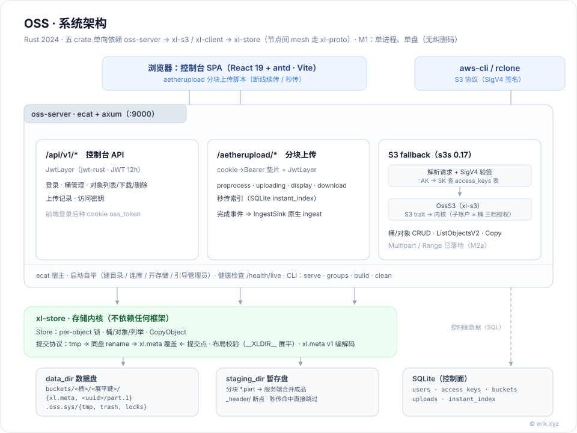
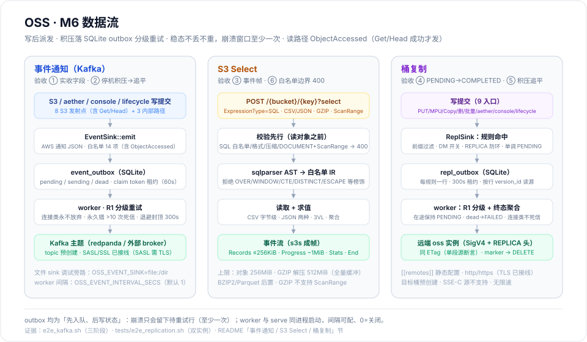
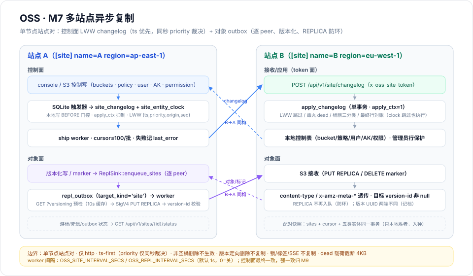
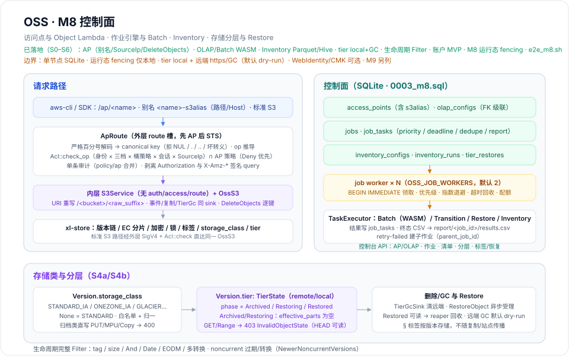
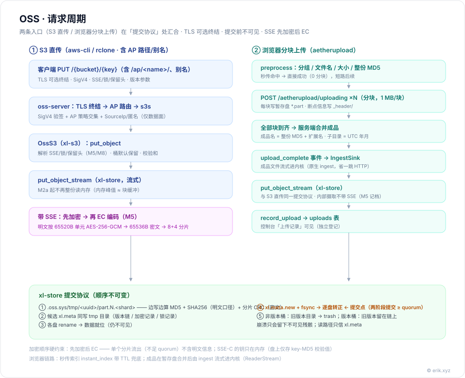
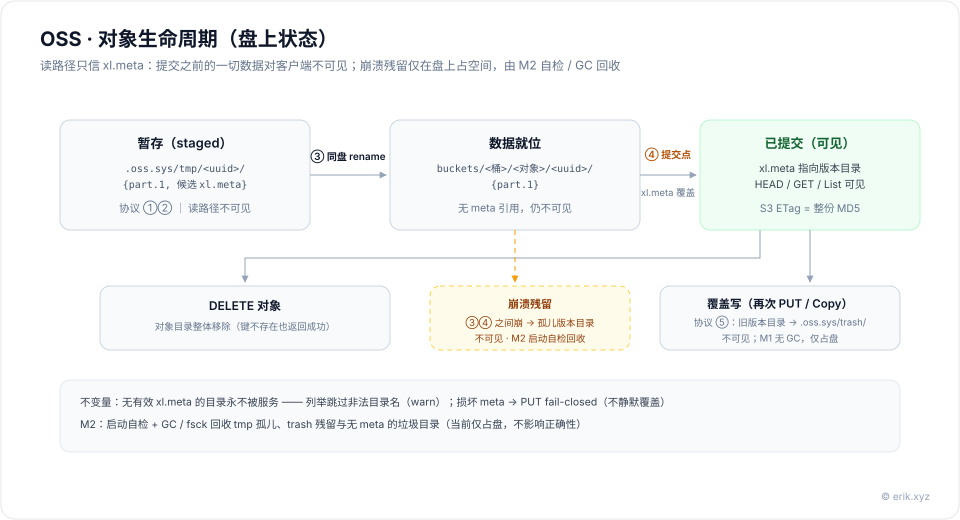

# oss (TunTun) — A Self-Built Distributed Object Storage System

[简体中文](README.md) | English

   

**Chinese project name: 吞吞 (TunTun) · English name: oss · Project pet: TunTun (吞吞)** — a little creature that swallows object blocks into its bucket.

An S3-compatible, self-built distributed object storage system (an equivalent implementation of MinIO). It supports multi-drive erasure coding 8+4, inter-node gRPC mesh, versioning, lifecycle, bucket policies and auditing, three SSE modes and object lock, STS temporary credentials, event notifications/Kafka, S3 Select, bucket and multi-site replication, access points/Object Lambda, Batch/Inventory/tiering, sync buckets and a 3-voter Raft control plane. The default `aws-cli`/`rclone` large-file paths (automatic multipart for ≥8 MiB) and resume habits work directly; the browser console supports chunked uploads and management.

**Latest release: v1.24.0 (2026-10-30).** M8-2 run-state replication now covers inventory and lifecycle cursors (feature level 5): `jobs`/`job_tasks` and Restore intake rows (level 4), plus `inventory_runs`/`cursors`/`incremental` and `lifecycle_cursors` (level 5), through Raft. Enabling feature 5 requires upgrading the whole cluster and removing/upgrading old nodes (one-way gate); legacy local inventory/lifecycle history is not migrated. See the [usage docs](https://oss.erik.xyz/usage.html#boundaries) for capability boundaries.

## Features

| Area | Capability |
|---|---|
| Storage kernel | Multi-drive erasure coding 8+4, inter-node gRPC mesh, quorum commit, `xl.meta` version chain, small-object inlining, multi-drive self-healing |
| S3 API | Objects/buckets/versions/tags, Multipart, partNumber, Range, Copy directives, chunked upload and resume |
| Lifecycle | Expiration, noncurrent versions, transition rules, Storage Classes, tiering and Restore |
| Security | SSE-S3/KMS/C, key vault, object lock and retention, STS, bucket policies and auditing, TLS/mTLS, three-tier sub-account permissions, Argon2id, account soft byte quota alerts |
| Data flow | Event notifications/Kafka, S3 Select, bucket replication, multi-site replication |
| Control plane | Access points, Object Lambda, Batch Operations, Inventory, job engine, console pages |
| Strong consistency | Sync buckets, stretch 2×6, 3-voter Raft (witness), feature levels 1..3 |
| Operations | `fsck` / `heal` / `scrub` / `clean` / `rebalance` / `cluster-shrink plan/apply/verify/commit/rollback` |
| Clients | `aws-cli` / `rclone`; React console (chunking, resume, instant upload) |

## Architecture



Data flow (event notifications / S3 Select / bucket replication):



Multi-site async replication (control-plane changelog + object outbox):



Control plane (access points and OLAP / jobs and Batch / Inventory / tiering and Restore / console pages):



| crate / directory | Responsibility |
|---|---|
| `crates/xl-store` | Storage kernel: drive layout and key validation (`__XLDIR__` flattening), `xl.meta` encoding/decoding (version chain / encryption records / lock records / tags / storage_class / tier), commit protocol, EC encode/decode, multi-drive distribution and quorum, object/bucket locks and flock, key vault (`kms.rs`) and block-aligned envelope encryption (`crypto.rs`) |
| `crates/xl-s3` | s3s `S3` trait implementation: DTO translation, error mapping, SigV4 authentication (AK → SK lookup in SQLite `access_keys`), SSE and object-lock header parsing/response assembly; includes access point routing (`ap.rs`), Object Lambda (`olap.rs`), Restore/lifecycle (`restore.rs`/`lifecycle.rs`), TierGc/bucket-delete cleanup contract |
| `crates/xl-proto` | Inter-node gRPC protocol: `oss.proto` messages and service definitions (fully generated by prost + tonic-build) |
| `crates/xl-client` | tonic implementation of the mesh: `TonicMesh` client (lazy connect / timeouts / token interceptor + traceparent injection) and server-side handler (token validation, only operates on this node's local slots) |
| `crates/oss-server` | ecat + axum assembly: console API (JWT), aetherupload wiring, S3 fallback, ops CLI; includes job engine (`jobs.rs`), Batch (`job_actions*.rs`), access points/OLAP (`access_points_api.rs`), Inventory (`inventory*.rs`), tiering/restore (`tier*.rs`) and the 0003 migration |
| `web` | Console frontend: React 19 + antd + Vite, Playwright e2e; includes access point/job/tier/inventory/notification/audit/settings pages |

Disk layout quick note (multi-drive): each drive holds one **complete namespace** — under `<drive>/<bucket>/<flattened-key>/` are `xl.meta` (this drive's replica) and version directories `<uuid>/part.1.<shard>` (the shards that land on this drive; in single-drive form, all shards). **A commit is always "data in place first → meta flip"**: single drive = rename on the same drive; multi-drive = two-phase meta commit per drive (prepare `xl.meta.new` on all drives ≥ quorum before flipping each to final; reads pick the **newest replica**). Small objects (< 128 KiB) are inlined into `xl.meta` and do not get data files. With encryption enabled, data files hold **ciphertext shards** (encrypt then EC), and the wrapped DEK and `key_id` are recorded inside `xl.meta` (the metadata itself contains no plaintext keys). Scratch areas are under `.oss.sys/{tmp, trash, locks}` on each drive; the `drive-id` drive identity marker prevents using the wrong drive.
Control-plane metadata (users/keys/buckets/upload records/instant-upload index) lives in SQLite.

**Tech stack**: Rust 2024 · ecat 7.0 · s3s 0.17 · aetherupload-rust 3.0.0 · axum 0.8 · sqlx / SQLite · serde + rmp-serde.

## Request Lifecycle



Both entry points (direct S3 upload, browser chunked upload) converge at xl-store's **commit protocol**: stage → rename data into place on the same drive → overwrite `xl.meta` to commit; everything before commit is invisible to clients. EC writes/range reads are chunk-streamed: peak memory ≈ the block buffer (MiB level), independent of object size (a 96 MiB object measured VmHWM 107 MiB for range reads). **Full-object GET still buffers the whole object**, so memory grows with object size — use Range for large downloads, and do not size capacity on "memory independent of object size" until streaming GET lands. Full-object GET is capped by `OSS_MAX_BUFFERED_GET_BYTES` (default 512 MiB, 0=unlimited); a single list collects at most `OSS_LIST_MAX_KEYS` keys (default 1,000,000, 0=unlimited) — use prefixes for large buckets. Audit logs are retained for 90 days by default (`OSS_AUDIT_RETENTION_DAYS=0` disables cleanup); expired instant-upload index rows are purged hourly. `jobs`/`job_tasks` run-state is carried in the Raft snapshot (`m8.runstate`, hard cap 64 MiB) and has **no automatic retention yet**; a warning fires near the cap, and finished jobs must be pruned in a maintenance window (a feature-level-6 `JobPurge` command is a separate milestone).

## Object Lifecycle



The read path trusts only `xl.meta`: directories without valid meta are never served; a crash can only leave invisible debris (orphan version directories / leftover trash / incomplete multipart staging areas). At startup the service self-checks and clears `tmp`/`trash`; `oss-server clean <days>` reclaims the remaining debris by mtime.

Bucket lifecycle rules handle expiration, noncurrent-version cleanup, Storage Class transitions, and tiered Restore; archived objects must be restored before reading.

## Installation

### From Source

```bash
# 1. Start the service (first start creates data/staging/bucket directories and the admin)
OSS_ADMIN_USER=erik OSS_ADMIN_PASSWORD=changeme cargo run -p oss-server

# 2. Log in to get a token
TOKEN=$(curl -s -X POST localhost:9000/api/v1/login -H 'content-type: application/json' \
  -d '{"username":"erik","password":"changeme"}' | python3 -c 'import json,sys;print(json.load(sys.stdin)["token"])')

# 3. Create an access key pair for S3 clients (re-running is idempotent)
curl -s -X POST localhost:9000/api/v1/access-keys -H "authorization: Bearer $TOKEN" \
  -H 'content-type: application/json' \
  -d '{"access_key":"AKIA_TEST_ACCESS_KEY","secret_key":"SK_TEST_SECRET_KEY_0001"}'
```

> `oss.toml` defaults to `listen = "127.0.0.1:9000"` (local only) and a placeholder `jwt_secret` for local development only. If you change `listen` to a non-loopback address, the placeholder secret **refuses to start**; set a random `jwt_secret` before exposing the service.

### Docker

Single node (oss-server + console nginx):

```bash
docker compose up --build        # console http://localhost:8080 · S3/API http://localhost:9000
```

Cluster (4 nodes × 3 drives = 12 slots; service names are node addresses):

```bash
docker compose -f docker-compose.cluster.yml up --build
# S3/control-plane entry: n1:9000 · n2:9001 · n3:9002 · n4:9003 (any node equivalent); console :8080 reverse-proxies n1
```

- Config: single node `docker/oss.toml`; cluster `docker/cluster/n{1..4}/oss.toml` (static topology, commented in the files).
- If `jwt_secret` / cluster `secret` / the admin password are unset, they are generated on first start and written to `./docker/secrets/generated.env` (mode **0600**, owner `oss`, directory 0700); rotate by deleting that file and restarting. Read it with `docker compose exec oss cat /secrets/generated.env` (cluster: `docker compose -f docker-compose.cluster.yml exec n1 cat /secrets/generated.env`), or `sudo cat docker/secrets/generated.env` on the host.
- Published ports bind `127.0.0.1` by default (9000 S3/API, 8080 console). To expose externally, remove the `127.0.0.1:` prefix from the compose port mapping and add TLS/reverse proxy plus access control yourself; inter-container traffic still uses the `oss:9000` service name and is unaffected.
- The console image still runs `nginx:alpine` with its default root master process on :80; making it non-root requires a non-privileged base image/port and matching compose/healthcheck changes (not done here).
- Data/staging live in named volumes (cleared only by `docker compose down -v`); each cluster node has its own volume.

### Console

```bash
# 1. Start the backend (same as "From Source")
OSS_ADMIN_USER=erik OSS_ADMIN_PASSWORD=changeme cargo run -p oss-server
# 2. Start the frontend (another terminal)
cd web && npm install && npm run dev
# 3. Open http://127.0.0.1:5173 and log in with the account above
```

> Full TLS, cluster, strong-consistency, and production deployment instructions are in the [installation docs](https://oss.erik.xyz/install.html).

## Usage

```bash
export AWS_ACCESS_KEY_ID=...
export AWS_SECRET_ACCESS_KEY=...
export AWS_DEFAULT_REGION=us-east-1
E=http://127.0.0.1:9000

aws --endpoint-url $E s3 mb s3://photos
aws --endpoint-url $E s3 cp ./cover.jpg s3://photos/cover.jpg
aws --endpoint-url $E s3 ls s3://photos/
aws --endpoint-url $E s3 presign s3://photos/cover.jpg --expires-in 3600
aws --endpoint-url $E s3 rm s3://photos/cover.jpg
```

- Large files automatically use multipart; Range, `x-amz-meta-*`, Storage Class, and object tags follow S3 semantics.
- The browser console covers buckets, objects, users, access keys, permissions, access points, jobs, Inventory, tiering, and Raft cluster status.
- Versioning, lifecycle, encryption, object lock, STS, event notifications, replication, strong consistency, and ops commands are covered in the [usage docs](https://oss.erik.xyz/usage.html).
- The full API and protocol boundaries are in the [API docs](https://oss.erik.xyz/api.html).

---

© 2026 erik.xyz · Released under the Apache-2.0 license

<!-- assets-license:start -->
## Visual Assets License

The project pet, images, icons, and expressions of this project (including SVG / PNG files under directories such as `docs/pet-expressions/`) **are not open-source assets**; copyright belongs to the author. Copying, modifying, redistributing, or using them for commercial purposes without written permission is prohibited; commercial use requires a commercial license — contact **erik@erik.xyz**. See [ASSETS-LICENSE.md](ASSETS-LICENSE.md) for details.

> The code portion remains under the repository's original `LICENSE`; third-party assets (e.g. the Go Gopher where explicitly noted) remain under their own licenses.
<!-- assets-license:end -->

<!-- pet-expressions:start -->
## Project Pet Expression Forms · TunTun

12 colorful animated forms: smile / joy / cry / dejected / terrified / angry / coquettish / cute / pleasing / knocking / facepalm / tongue. Each SVG has its own expression, emotion effects, and overall animation; individual files are in [`docs/pet-expressions/`](docs/pet-expressions/).



| Form | Code | Form | Code | Form | Code |
| --- | --- | --- | --- | --- | --- |
| [Smile](docs/pet-expressions/smile.svg) | `:emoji-smile:` | [Joy](docs/pet-expressions/joy.svg) | `:emoji-joy:` | [Cry](docs/pet-expressions/cry.svg) | `:emoji-cry:` |
| [Dejected](docs/pet-expressions/dejected.svg) | `:emoji-depressed:` | [Terrified](docs/pet-expressions/terrified.svg) | `:emoji-terrified:` | [Angry](docs/pet-expressions/angry.svg) | `:emoji-angry:` |
| [Coquettish](docs/pet-expressions/spoiled.svg) | `:emoji-coquettish:` | [Cute](docs/pet-expressions/cute.svg) | `:emoji-cute:` | [Pleasing](docs/pet-expressions/plead.svg) | `:emoji-pleasing:` |
| [Knocking](docs/pet-expressions/knock.svg) | `:emoji-knocking:` | [Facepalm](docs/pet-expressions/facepalm.svg) | `:emoji-facepalm:` | [Tongue](docs/pet-expressions/tongue.svg) | `:emoji-tongue:` |
<!-- pet-expressions:end -->
